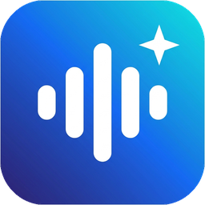

<p align="center">
  
</p>

<h1 align="center">AudioCpp-Desktop</h1>

<p align="center">
  Native Windows WPF (.NET 8) desktop console for <a href="https://github.com/0xShug0/audio.cpp">audio.cpp</a> local multi-model TTS &amp; ASR servers
</p>

<p align="center">
  <strong>English</strong> | <a href="README_ZH.md">简体中文</a>
</p>

---

## Features

- **One-Click Server Control & System Tray**
  - Switch between CUDA GPU acceleration and CPU mode, configure listen port and `max_loaded_models` (recommended `1` to auto-free VRAM on model switch), minimize to system tray, and cleanly terminate the server on exit.
- **Standard OpenAI-Compatible API**
  - Exposes `/v1/audio/speech`, `/v1/audio/voices`, and `/v1/audio/transcriptions` with one-click LAN URL and Model ID copy — works out of the box with **Open WebUI**, **SillyTavern**, **Legado**, **CloneTTS**, and any OpenAI TTS client.
- **Visual Dual-Source GGUF Model Manager**
  - Built-in catalog of 6 TTS models (`M5-TTS`, `Qwen3-TTS 0.6B / 1.7B`, `CosyVoice 3`, `VoxCPM 2`, `IndexTTS 2.5`) + 2 ASR models (`Fun-ASR-Nano 2512`, `Qwen3-ASR 0.6B`).
  - Resumable HTTP downloads from **HuggingFace** (`audio-cpp/audio.cpp-gguf`) or **ModelScope China Mirror** (`ziansoft/audiocpp-tts-gguf`) with automatic `GGUF` magic header validation.
  - Supports customizable model folder paths across drives without duplicating large files.
- **Voice Library & Built-in ASR Auto-Transcribe**
  - Manage `.wav` reference voices and edit `prompt_text` in a table, preview audio, auto-convert `.mp3`/`.m4a`/`.flac` to 24 kHz mono `.wav` via `ffmpeg`, and auto-transcribe reference transcripts using local `Fun-ASR-Nano` or `Qwen3-ASR`.
- **Extensible JSON Language Packs**
  - Ships with `locales/en.json` and `locales/zh.json` (embedded fallback + external override). Drop any new `locales/<code>.json` file next to the executable to add a new language immediately.

## Download

Go to [GitHub Releases](https://github.com/sipeter/AudioCpp-Desktop/releases):

- **`AudioCpp-Desktop-AllInOne-v0.1.0-win-x64-cuda12.7z`** (~579 MB, Recommended): Ready-to-run Windows x64 bundle including `AudioCpp-Desktop.exe`, `locales/`, `audio.cpp v0.9.6`, and minimal CUDA 12 / CPU runtime (no Python, .NET, or CUDA Toolkit installation required).
- **`AudioCpp-Desktop-v0.1.0-win-x64.zip`** (~63 MB): Standalone zero-dependency Windows GUI + `locales/` only (for users who already have `audio.cpp` binaries).

## Build from Source

Requires [.NET 8 SDK](https://dotnet.microsoft.com/) on Windows:

```powershell
# Development build
dotnet build -c Release

# Self-contained single-file EXE (zero .NET runtime prerequisite on target PCs)
dotnet publish -c Release -r win-x64 -p:SelfContained=true -p:PublishSingleFile=true -p:IncludeNativeLibrariesForSelfExtract=true -p:EnableCompressionInSingleFile=true -p:DebugType=none -o publish-dist
```

## Contributing Translations

Copy `locales/en.json` to `locales/<lang>.json` (e.g., `locales/ja.json`), update `_lang_name` and the string values, and place it in the `locales/` folder next to `AudioCpp-Desktop.exe`. Pull requests are welcome!

## Credits & License

- **AudioCpp-Desktop** source code is licensed under the **Apache License 2.0** (see [LICENSE](LICENSE)).
- Inference engine: [0xShug0/audio.cpp](https://github.com/0xShug0/audio.cpp) (Apache-2.0).
- Model weights: [audio-cpp/audio.cpp-gguf](https://huggingface.co/audio-cpp/audio.cpp-gguf) / [ziansoft/audiocpp-tts-gguf](https://www.modelscope.cn/models/ziansoft/audiocpp-tts-gguf) (each model follows its respective upstream license).
